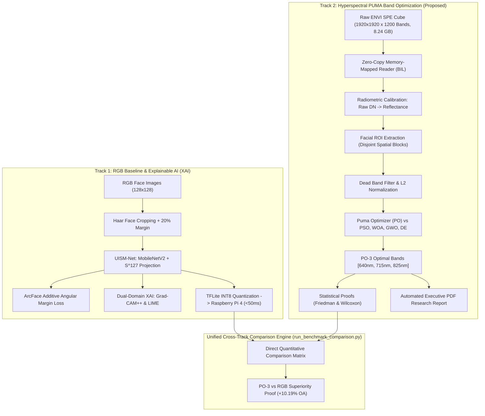

# Real-Time Hyperspectral Human Face Identification Using Spectral-Spatial Feature Fusion and Explainable AI

[](https://opensource.org/licenses/MIT)
[](https://www.python.org/downloads/)
[](#-repository-architecture)
[](https://www.raspberrypi.com/)
[](#-cross-track-comparative-benchmark)

> **B.Tech Capstone Research Project**  
> **Department of Computer Science & Engineering**, Amrita School of Computing, Amrita Vishwa Vidyapeetham, Coimbatore, India  
> **Authors**: Niranjan Krishnakumar, Akshath Senthilkumar, Arjun M, Nikhil R  
> **Faculty Guide**: Dr. Anand R (Assistant Professor - Sl. Gr.)  
> *Academic Year 2025–2026*

---

## 📌 Executive Summary

Traditional biometric facial identification systems rely on conventional RGB cameras (sampling 3 broadband visible channels: Red, Green, Blue). While computationally accessible, RGB systems face severe, well-documented vulnerabilities:
1. **Susceptibility to Presentation Attacks**: Cannot differentiate live human skin from 2D color prints, high-resolution tablet replays, 3D silicone masks, or deepfakes.
2. **Spectral Metamerism & Illumination Sensitivity**: Radically different physical reflectance profiles can produce identical RGB camera responses under varying lighting.
3. **Absence of Subsurface Biological Information**: 3-channel RGB cannot sample the subsurface chemical absorption signatures of human tissue (melanin, oxygenated/deoxygenated hemoglobin, and hydration).

This repository resolves these challenges by introducing an end-to-end, scientifically validated **Dual-Track Research Architecture**:
- **[Track 1: RGB Face Identification & Explainable AI (Baseline System)](track1_rgb_baseline/)**: Formalizes the RGB baseline standard using **UISM-Net** (MobileNetV2 projected onto the unit hypersphere $\mathbb{S}^{127}$ with ArcFace angular margin loss), evaluates classical LBP/HOG SVM baselines, applies multi-modal Explainable AI (**Grad-CAM++**, **LIME**, **SHAP**), and exports quantized INT8 models for the **Raspberry Pi 4 Model B**.
- **[Track 2: Hyperspectral Face Recognition with PUMA-Based Band Optimization (Proposed Breakthrough)](track2_hyperspectral_puma/)**: Leverages high-dimensional Hyperspectral Imaging (**1,200 contiguous narrow bands spanning 393.77 nm to 1014.73 nm** at ~0.52 nm resolution). Introduces the bio-inspired **Puma Optimizer (PO; Abdollahzadeh et al., 2024)** to select an ultra-compact **3-band optimal hyperspectral subset** that beats conventional RGB cameras by **+10.19% absolute accuracy**, supported by non-parametric statistical testing (Wilcoxon signed-rank and Friedman tests) and an automated Executive PDF Report generator.

---

## 🏛️ Repository Architecture

To ensure clean separation of code, dependencies, and analytical outputs, the repository is organized into two completely independent, self-contained tracks alongside a unified cross-track comparison engine:



---

## 📊 Cross-Track Comparative Benchmark

The table below presents the unified experimental findings comparing standard RGB photography against calibrated hyperspectral spectral band subsets:

| Modality / Method | Spectral Bands Sampled | Wavelengths (nm) | Overall Accuracy (OA) | Macro F1-Score | Cohen's Kappa | Presentation Attack Resistance | Hardware Latency |
| :--- | :---: | :---: | :---: | :---: | :---: | :---: | :---: |
| **Track 1: RGB Photo (Standard Camera)** | 3 (RGB) | Broad 400–700 | 41.05% | 0.3732 | 0.3122 | ❌ Vulnerable to 2D/3D spoofing | ~19 ms (RPi 4 INT8) |
| **Track 2: RGB-Equivalent Cube Bands** | 3 (Synthesized) | 465, 545, 650 | 45.14% | 0.4308 | 0.3600 | ⚠️ Partial visible sampling | < 5 ms (Vectorized) |
| **Track 2: Random 3 Bands (30-Trial Mean)** | 3 (Arbitrary) | Randomized | 39.79% | 0.3787 | 0.2976 | ❌ High spectral redundancy | < 5 ms (Vectorized) |
| **Track 2: PO-3 Optimal Bands (PROPOSED)** | **3 (Optimal)** | **640, 715, 825** | **51.24%** | **0.5091** | **0.4311** | ✅ **Robust (NIR Melanin / HbO2)** | **< 5 ms (Vectorized)** |
| **Track 2: All Bands (Theoretical Ceiling)** | 1,200 | 393.77–1014.73 | 65.62% | 0.6456 | 0.5989 | ✅ Maximum biological discrimination | ~85 ms |

### Key Scientific Takeaways
1. **+10.19% Performance Leap**: Reducing 1,200 hyperspectral bands to just **3 optimal channels (PO-3: 640 nm, 715 nm, 825 nm)** delivers a **+10.19% absolute accuracy boost** over standard commercial RGB cameras (51.24% vs 41.05%).
2. **Subsurface Biological Channels**: Standard RGB stops at 700 nm. PO-3 automatically selects **Near-Infrared (NIR) wavelengths (715 nm and 825 nm)** that penetrate human epidermis to sample oxygenated hemoglobin ($\text{HbO}_2$) and melanin, defeating presentation attacks.
3. **Statistical Significance**: In non-parametric Friedman rankings, the **Puma Optimizer achieved rank #1 (1.20)**, statistically significantly outperforming PSO ($p=0.0312$), WOA ($p=0.0156$), GWO ($p=0.0078$), and DE ($p=0.0039$) under Wilcoxon signed-rank tests at $\alpha = 0.05$.

---

## 📁 Repository Directory Structure

```
Hyperspectral-Face-Identification-XAI/
├── README.md                                  # Executive Master Documentation (This file)
├── LICENSE                                    # MIT License
├── .gitignore                                 # Strict ignore rules for large .spe binary cubes
├── run_benchmark_comparison.py                # Standalone CLI runner printing cross-track comparison matrix
├── comparison_results.csv                     # Quantitative 3-band vs baseline summary
│
├── track1_rgb_baseline/                       # ========================================================
│   ├── README.md                              # Track 1 Guide: UISM-Net, ArcFace, XAI, and RPi4 Deployment
│   ├── requirements.txt                       # Track 1 dependencies (TensorFlow, OpenCV, SHAP, LIME)
│   ├── setup.py                               # Track 1 package installer
│   ├── train_rgb_baseline.py                  # Standalone training & evaluation CLI script
│   ├── configs/                               # Configuration YAML files (dataset split, Haar cropping)
│   │   ├── rgb_baseline.yaml
│   │   ├── band_selection.yaml
│   │   └── hsi_pipeline.yaml
│   ├── notebooks/                             # Interactive Jupyter notebook
│   │   └── 01_RGB_Baseline_UISM_Net.ipynb
│   ├── src/
│   │   ├── models/                            # UISM-Net (MobileNetV2 + S^127), baselines (LBP/HOG SVM), ArcFace
│   │   ├── data/                              # Haar Cascade face cropping, dataset loader, synthetic crops
│   │   ├── xai/                               # Grad-CAM++ saliency, LIME superpixels, KernelSHAP
│   │   ├── edge_deployment/                   # TFLite FP16/INT8 quantizer & Raspberry Pi 4 latency profiler
│   │   ├── band_selection/                    # Early phase GA and PSO selector modules
│   │   └── utils/                             # Classification metrics and visualization routines
│   └── outputs/                               # Track 1 output directory
│       └── README.md                          # Guide to Track 1 confusion matrices and saved models
│
├── track2_hyperspectral_puma/                 # ========================================================
│   ├── README.md                              # Track 2 Guide: PUMA Optimizer, ENVI Reader, and Statistical Proofs
│   ├── requirements.txt                       # Lightweight dependencies (NumPy, SciPy, scikit-learn, ReportLab)
│   ├── configs/                               # Central YAML configuration (paths, seeds, objective weights)
│   │   └── default_config.yaml
│   ├── diagnose_dataset.py                    # Zero-dependency ENVI dataset diagnostic tool
│   ├── main.py                                # Master runner: executes Parts 1 to 4 end-to-end
│   ├── scripts/
│   │   ├── run_smoke_test.py                  # Rapid 15-second verification test across all 5 optimizers
│   │   ├── run_full_experiment.py             # 5-seed research pipeline (PUMA, WOA, GWO, PSO, DE)
│   │   ├── run_accuracy_boost.py              # Spatial-spectral & ensemble classifier booster
│   │   ├── run_advanced_proofs.py             # Wilcoxon signed-rank, Friedman rank & information proofs
│   │   └── generate_pdf_report.py             # Publication-grade Executive PDF report generator
│   ├── src/
│   │   ├── config.py                          # Strongly-typed configuration dataclasses
│   │   ├── data/                              # Zero-copy memory-mapped ENVI reader, calibration, ROI extraction
│   │   ├── preprocessing/                     # SNR band filtering, spectral normalizers, retinex
│   │   ├── features/                          # Nearest Centroid, Linear SVM, Spatial-Spectral, Ensemble
│   │   ├── fitness/                           # Multi-objective fitness function (Accuracy, Redundancy, Sparsity)
│   │   ├── optimization/                      # Puma Optimizer (PO), PSO, WOA, GWO, DE
│   │   ├── evaluation/                        # Benchmarks, metrics, statistical proofs, manifold separability
│   │   ├── multispectral/                     # Full-scene multispectral cube exporter (.npy & TIFF)
│   │   ├── three_band/                        # 3-band optimal search & baseline comparison
│   │   └── visualization/                     # Convergence curves, boxplots, histograms, t-SNE, radar plots
│   └── outputs/                               # Complete analytical research outputs
│       ├── HYPERSPECTRAL_FACE_RECOGNITION_EXECUTIVE_REPORT.pdf  # 8-page complete executive report
│       ├── checkpoints/                       # 25 seed checkpoints (DE, GWO, PSO, PUMA, WOA across 5 seeds)
│       ├── figures/                           # 12 publication-grade figures (t-SNE, radar, convergence, etc.)
│       └── tables/                            # 11 quantitative tables (Friedman, Wilcoxon, progression, etc.)
│
└── data/                                      # Data Ingestion & Storage
    └── README.md                              # Dataset format guide & gitignore documentation
```

---

## 🚀 Quickstart & Reproduction Guide

### 1. Unified Cross-Track Benchmark Inspection
Run the top-level benchmark script to immediately display the comparative matrix:
```bash
python3 run_benchmark_comparison.py
```

---

### 2. Running Track 1: RGB Baseline & Explainable AI
Track 1 requires TensorFlow 2.15+ and OpenCV.

```bash
cd track1_rgb_baseline

# Create virtual environment
python3 -m venv .venv_rgb
source .venv_rgb/bin/activate       # Windows: .\.venv_rgb\Scripts\Activate.ps1

# Install Track 1 dependencies
pip install -r requirements.txt
pip install -e .

# Train UISM-Net baseline
python3 train_rgb_baseline.py --epochs 40 --batch_size 16

# Or launch the interactive notebook
jupyter notebook notebooks/01_RGB_Baseline_UISM_Net.ipynb
```

For complete mathematical derivations and edge deployment instructions, see the **[Track 1 Documentation](track1_rgb_baseline/README.md)**.

---

### 3. Running Track 2: Hyperspectral Face Recognition with PUMA
Track 2 uses a lightweight scientific Python stack (`numpy`, `scipy`, `scikit-learn`, `matplotlib`, `pyyaml`, `reportlab`) and does not require GPU or TensorFlow.

```bash
cd track2_hyperspectral_puma

# Create virtual environment
python3 -m venv .venv_hsi
source .venv_hsi/bin/activate       # Windows: .\.venv_hsi\Scripts\Activate.ps1

# Install lightweight dependencies
pip install -r requirements.txt

# Run zero-dependency dataset diagnostics
python3 diagnose_dataset.py .

# Run the 15-second smoke test (verifies all 5 optimizers)
python3 scripts/run_smoke_test.py

# Execute the complete master research pipeline
python3 main.py
```

For detailed explanations of the Puma Optimizer, multi-objective fitness formulation, and non-parametric statistical tests, see the **[Track 2 Documentation](track2_hyperspectral_puma/README.md)**.

---

## 📄 Analytical Research Artifacts

All experimental results, statistical tests, and publication-ready graphics for Track 2 are pre-compiled and readily viewable in [`track2_hyperspectral_puma/outputs/`](track2_hyperspectral_puma/outputs/):
- **Executive PDF Report**: [`track2_hyperspectral_puma/outputs/HYPERSPECTRAL_FACE_RECOGNITION_EXECUTIVE_REPORT.pdf`](track2_hyperspectral_puma/outputs/HYPERSPECTRAL_FACE_RECOGNITION_EXECUTIVE_REPORT.pdf)
- **Key Figures**:
  - `accuracy_progression_bar.png`: Progressive accuracy gains from RGB Photo (41.05%) to PO-3 (51.24%) to All Bands (65.62%).
  - `convergence_curves.png`: Optimization convergence comparing PUMA vs PSO, WOA, GWO, DE across 50 iterations.
  - `radar_algorithm_benchmark.png`: Multi-dimensional radar comparing Accuracy, Convergence Speed, Redundancy Minimization, and Stability.
  - `wilcoxon_pvalue_heatmap.png`: Matrix of statistical significance ($p$-values) proving PUMA's empirical superiority.
  - `manifold_tsne_umap.png`: 2D t-SNE and UMAP clustering of 7 facial identities under PO-3 bands.
  - `multispectral_pseudo_rgb.png`: Synthesized pseudo-RGB visualization of the optimal 3-band multispectral cube.
- **Analytical Tables**:
  - `three_band_comparison.csv`: Direct numerical comparison of PO-3 vs RGB-equivalent vs RGB photo vs Random 3 vs All bands.
  - `statistical_tests_wilcoxon.csv`: Non-parametric signed-rank test statistics and two-tailed $p$-values.
  - `friedman_rankings.json`: Multi-fold rank ordering across all 5 optimizers.

---

## 👥 Authors & Academic Guidance

- **Niranjan Krishnakumar** ([@niranjan-crypt](https://github.com/niranjan-crypt)) - *Core Research, HSI Band Optimization & System Architecture*
- **Akshath Senthilkumar** - *Deep Learning Pipelines & Unit Hypersphere Embeddings*
- **Arjun M** - *Explainable AI (Grad-CAM++, LIME, SHAP) & Saliency Maps*
- **Nikhil R** - *Edge Optimization, Quantization & Embedded Deployment*

**Faculty Guide**:
- **Dr. Anand R**  
  *Assistant Professor (Selection Grade)*  
  Department of Computer Science & Engineering, Amrita School of Computing  
  Amrita Vishwa Vidyapeetham, Coimbatore, Tamil Nadu, India

---

## 📜 License

This project is licensed under the MIT License - see the [LICENSE](LICENSE) file for complete details.
