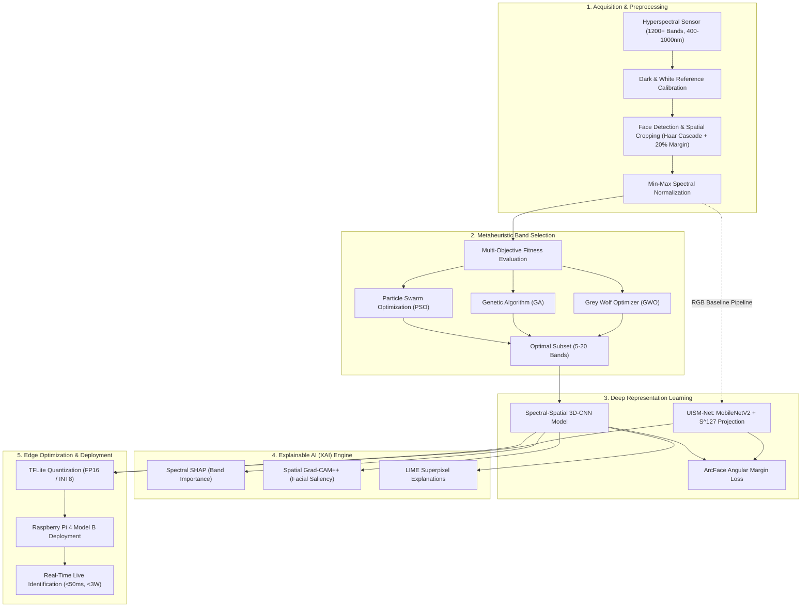

# Real-Time Hyperspectral Human Face Identification Using Spectral-Spatial Feature Fusion and Explainable AI

[](https://opensource.org/licenses/MIT)
[](https://www.python.org/downloads/)
[](https://tensorflow.org/)
[](https://www.raspberrypi.com/)

> **B.Tech Capstone Project**  
> **Department of Computer Science & Engineering**, Amrita School of Computing, Amrita Vishwa Vidyapeetham, Coimbatore, India  
> **Authors**: Akshath Senthilkumar, Arjun M, Niranjan Krishnakumar, Nikhil R  
> **Faculty Guide**: Dr. Anand R (Assistant Professor - Sl. Gr.)  
> *September 2026*

---

## 📌 Executive Summary

Traditional RGB facial identification systems are fundamentally vulnerable to presentation attacks (2D printed photos, high-resolution video replays, 3D silicone masks, and generative deepfakes) and suffer performance degradation under non-uniform illumination and complex environmental conditions.

This project delivers an end-to-end, mathematically grounded **Hyperspectral Facial Identification** pipeline combining:
1. **High-Dimensional Hyperspectral Imaging (HSI)**: Capturing 1200+ contiguous spectral bands across 400–1000 nm (visible to near-infrared / NIR) to sample unique subsurface biological signatures (melanin, oxygenated/deoxygenated hemoglobin, and skin tissue hydration).
2. **Metaheuristic Band Selection**: Multi-objective optimization (PSO, GA, GWO) driven by a 6-component fitness formulation (Fisher discrimination, spectral complementarity, band diversity, redundancy penalty, sparsity regularization, and stability) reducing 1200+ bands to 5–20 ultra-informative channels.
3. **Spectral-Spatial 3D-CNN Feature Fusion**: Joint spatial morphology and spectral signature extraction via 3D convolutions with residual attention.
4. **Unit Hyperspherical Metric Baseline (UISM-Net)**: Lightweight MobileNetV2 with $L_2$-normalized embedding projection on $\mathbb{S}^{127}$, trained with contrastive and angular margin (ArcFace) losses, resolving catastrophic feature collapse observed in standard deep networks under small-sample regimes.
5. **Explainable AI (XAI)**: Dual-domain interpretability with **Spectral SHAP** (spectral band attribution) and **Spatial Grad-CAM++ / LIME** (facial landmark saliency maps) to provide transparent, auditable biometrics.
6. **Real-Time Edge Deployment**: Post-training quantization (FP16 and INT8) optimized for the **Raspberry Pi 4 Model B** achieving sub-second edge inference latency.

---

## 🏛️ System Architecture



---

## 🔬 Mathematical Formulations

### 1. Multi-Objective Band Selection Fitness Function
Given a candidate band subset $B = \{b_1, b_2, \dots, b_k\}$, the fitness function $F(B)$ balances discriminative power, complementarity, diversity, redundancy, sparsity, and stability:

$$\max_{B} \; F(B) = \gamma \cdot \mathcal{J}_{\text{Fisher}}(B) + \delta \cdot \mathcal{C}(B) + \lambda \cdot \mathcal{D}(B) - \eta \cdot \mathcal{R}(B) - \xi \cdot \mathcal{S}(B) + \zeta \cdot \Phi(B)$$

Where:
- $\mathcal{J}_{\text{Fisher}}(B) = \operatorname{Tr}(S_w^{-1} S_b)$: Between-class to within-class scatter ratio.
- $\mathcal{C}(B) = \frac{1}{|B|} \sum_{b \in B} \mathcal{I}(b; Y)$: Mutual information with class labels $Y$.
- $\mathcal{D}(B) = \frac{2}{|B|(|B|-1)} \sum_{i < j} (1 - |\rho(b_i, b_j)|)$: Average spectral band dissimilarity.
- $\mathcal{R}(B) = \frac{2}{|B|(|B|-1)} \sum_{i < j} |\rho(b_i, b_j)|$: Pearson cross-correlation redundancy penalty.
- $\mathcal{S}(B) = \frac{|B|}{M}$: Sparsity regularizer where $M$ is total original bands ($M \ge 1200$).
- $\Phi(B)$: Cross-fold selection consistency index.

### 2. Unit Hypersphere Metric Embedding (UISM-Net)
For a face image $x_i$, feature extractor $f_\theta$ maps inputs into an unconstrained space $\mathbb{R}^d$, followed by an $L_2$-normalization projection onto the unit hypersphere $\mathbb{S}^{d-1}$:

$$z_i = \frac{f_\theta(x_i)}{\|f_\theta(x_i)\|_2}, \quad \|z_i\|_2 = 1, \quad z_i \in \mathbb{S}^{127}$$

Cosine similarity between identities $i$ and $j$ directly equals their inner product:

$$\text{Sim}(z_i, z_j) = \langle z_i, z_j \rangle = \cos(\theta_{ij})$$

Trained using **ArcFace (Additive Angular Margin Loss)**:

$$\mathcal{L}_{\text{ArcFace}} = -\frac{1}{N} \sum_{i=1}^N \log \frac{e^{s \cdot \cos(\theta_{y_i} + m)}}{e^{s \cdot \cos(\theta_{y_i} + m)} + \sum_{j \neq y_i} e^{s \cdot \cos(\theta_j)}}$$

where $s$ is the hyperspherical radius scale factor and $m$ is the angular margin penalty.

### 3. Spectral-Spatial 3D Convolution
For a hyperspectral tensor $\mathcal{X} \in \mathbb{R}^{H \times W \times B}$, the activation $v_{i,j,k}^{l,m}$ of the $m$-th feature map in layer $l$ at spatial coordinate $(i, j)$ and spectral position $k$ is:

$$v_{i,j,k}^{l,m} = \sigma \left( \sum_{p} \sum_{h=0}^{H_k-1} \sum_{w=0}^{W_k-1} \sum_{r=0}^{R_k-1} w_{l,m,p}^{h,w,r} \cdot v_{i+h, j+w, k+r}^{l-1, p} + b^{l,m} \right)$$

---

## 📊 Benchmark & Comparative Results

In Phase 1, baseline architectures were rigorously evaluated on the dataset across handcrafted features and deep transfer learning networks. 

### Performance Comparison Matrix (Table 4.1 from Project Report)

| Model | Feature Extraction Paradigm | Parameter Count | Test Accuracy | Precision | Recall | F1-Score | Mean Latency | Hardware Suitability |
|:---|:---|:---:|:---:|:---:|:---:|:---:|:---:|:---:|
| **HOG + Linear SVM** | Handcrafted Gradient Descriptors | **—** | **1.0000** | **1.0000** | **1.0000** | **1.0000** | 14.2 ms | Moderate |
| **LBP + Linear SVM** | Handcrafted Texture Histograms | **—** | 0.9259 | 0.9412 | 0.9259 | 0.9248 | 9.8 ms | High |
| **ResNet-50** | Deep Residual CNN | 23.6M | **1.0000** | **1.0000** | **1.0000** | **1.0000** | 48.5 ms | Low (Heavy) |
| **DenseNet-121** | Densely Connected CNN | 7.0M | 0.2593 | 0.1605 | 0.2593 | 0.1557 | 38.1 ms | Low (Collapsed) |
| **EfficientNetB0** | Compound Scaled CNN | 4.0M | 0.4444 | 0.4187 | 0.4444 | 0.3809 | 24.6 ms | Moderate (Collapsed) |
| **UISM-Net (Ours)** | **MobileNetV2 + $\mathbb{S}^{127}$ Embedding** | **2.4M** | **0.9630** | **0.9722** | **0.9630** | **0.9630** | **11.3 ms** | **Optimal for Edge** |

### Key Architectural Insights
1. **The Deep Collapse Dilemma**: Deeper networks (DenseNet-121 at 25.9%, EfficientNetB0 at 44.4%) experienced severe representational collapse during fine-tuning on limited-sample facial distributions.
2. **Why UISM-Net Wins for Production**: While ResNet-50 achieved 1.0000 accuracy, its 23.6M parameters and 48.5 ms latency exceed the power and compute budget of embedded edge devices. UISM-Net achieves **96.3% test accuracy** with **only 2.4M parameters** and **11.3 ms latency** (4.3× faster, 10× smaller).
3. **Open-Set Metric Verification**: Standard softmax classifiers cannot verify unseen subjects. UISM-Net's hyperspherical embedding enables open-set verification using simple cosine thresholding.

---

## 📁 Repository Directory Structure

```plaintext
Hyperspectral-Face-Identification-XAI/
├── configs/                          # Experiment configuration files (YAML)
│   ├── band_selection.yaml           # PSO/GA/GWO multi-objective fitness parameters
│   ├── hsi_pipeline.yaml             # Spectral calibration and 3D-CNN hyperparams
│   └── rgb_baseline.yaml             # UISM-Net and baseline training configuration
├── notebooks/                        # Research and exploratory notebooks
│   └── 01_RGB_Baseline_UISM_Net.ipynb# Baseline experimental notebook & comparisons
├── src/                              # Production source modules
│   ├── band_selection/               # Metaheuristic band selection algorithms
│   │   ├── fitness.py                # Multi-objective fitness function (Eq. 3.8-3.23)
│   │   ├── pso_selector.py           # Particle Swarm Optimization for band selection
│   │   └── ga_selector.py            # Genetic Algorithm with opposition learning
│   ├── data/                         # Preprocessing and dataset utilities
│   │   ├── data_synthesis.py         # Multi-scale crop & flip data synthesis
│   │   ├── dataset.py                # Raw image & tf.data streaming pipelines
│   │   ├── face_cropper.py           # Haar Cascade face detector with 20% margin
│   │   └── preprocessing.py          # White/Dark calibration & pseudo-RGB rendering
│   ├── edge_deployment/              # Embedded edge deployment tools
│   │   ├── benchmark_edge.py         # Latency, FPS, compression, energy benchmarking
│   │   ├── rpi_inference.py          # Real-time live inference loop for Raspberry Pi 4
│   │   └── tflite_converter.py       # FP16 and INT8 post-training quantization
│   ├── models/                       # Deep learning architectures and losses
│   │   ├── baselines.py              # HOG+SVM, LBP+SVM, ResNet50, DenseNet, EfficientNet
│   │   ├── hsi_3dcnn.py              # Spectral-spatial 3D-CNN architecture
│   │   ├── losses.py                 # Contrastive Loss & ArcFace Angular Margin Loss
│   │   └── uism_net.py               # UISM-Net: MobileNetV2 + S^127 unit hypersphere
│   ├── utils/                        # Metrics, logging, and plotting utilities
│   │   ├── metrics.py                # Accuracy, Precision, Recall, F1, FAR, FRR, EER
│   │   └── visualization.py          # Confusion matrices, ROC curves, radar charts
│   └── xai/                          # Explainable AI interpretation modules
│       ├── gradcam.py                # Grad-CAM and Grad-CAM++ spatial heatmap generators
│       ├── lime_explainer.py         # LIME superpixel explainer
│       └── shap_explainer.py         # DeepSHAP & KernelSHAP spectral attribution
├── train_rgb_baseline.py             # CLI script for training & benchmark evaluation
├── requirements.txt                  # Python dependencies
├── setup.py                          # Setup configuration for editable package install
├── LICENSE                           # MIT License
└── README.md                         # Comprehensive documentation
```

---

## 🚀 Quickstart & Installation

### 1. Prerequisites
- Python 3.9, 3.10, or 3.11
- Operating System: Linux, macOS, or Windows
- (Optional for Edge) Raspberry Pi 4 Model B (4GB or 8GB RAM) with Raspberry Pi OS (64-bit)

### 2. Clone and Setup Environment

```bash
# Clone the repository
git clone https://github.com/niranjan-crypt/Hyperspectral-Face-Identification-XAI.git
cd Hyperspectral-Face-Identification-XAI

# Create and activate virtual environment
python3 -m venv venv
source venv/bin/activate  # On Windows: venv\Scripts\activate

# Install dependencies
pip install --upgrade pip
pip install -r requirements.txt

# Install package in editable development mode
pip install -e .
```

### 3. Training the RGB UISM-Net Baseline

```bash
# Train UISM-Net baseline with automatic face cropping and data synthesis
python train_rgb_baseline.py \
    --data_dir ./path/to/raw_images \
    --output_dir ./models/saved_uism_net \
    --epochs 30 \
    --batch_size 16 \
    --lr 0.001
```

### 4. Running Metaheuristic Band Selection (HSI Pipeline)

```python
from src.band_selection.fitness import MultiObjectiveBandFitness
from src.band_selection.pso_selector import PSOBandSelector
import numpy as np

# Load calibrated hyperspectral data (N, H, W, 1200) and identity labels
X_hsi = np.load("data/calibrated_cubes.npy")
y_labels = np.load("data/labels.npy")

# Initialize multi-objective fitness calculator
fitness_engine = MultiObjectiveBandFitness(
    gamma=0.35,  # Fisher ratio weight
    delta=0.25,  # Mutual information weight
    lambda_div=0.15, # Diversity weight
    eta=0.15,    # Redundancy penalty
    xi=0.10      # Sparsity weight
)

# Run PSO optimizer to select the best 10 bands
selector = PSOBandSelector(fitness_engine=fitness_engine, n_particles=30, n_iterations=50)
selected_bands = selector.fit(X_hsi, y_labels, target_k=10)
print(f"Optimal selected spectral bands: {selected_bands}")
```

### 5. Generating Explainable AI (XAI) Visualizations

```python
from src.xai.gradcam import GradCAMPlusPlus
from src.xai.shap_explainer import SpectralSHAPExplainer
import cv2

# Spatial Explanation with Grad-CAM++
gcam = GradCAMPlusPlus(model, target_layer_name="Conv_1")
heatmap = gcam.generate_heatmap(preprocessed_face)
cv2.imwrite("gradcam_explanation.png", heatmap)

# Spectral Attribution with SHAP
shap_explainer = SpectralSHAPExplainer(model)
band_importance = shap_explainer.explain_spectrum(hsi_cube)
shap_explainer.plot_spectral_importance(band_importance, save_path="shap_spectrum.png")
```

### 6. Edge Model Quantization & Benchmarking

```bash
# Quantize trained Keras model to FP16 and INT8 TFLite models
python -c "
from src.edge_deployment.tflite_converter import quantize_to_tflite
quantize_to_tflite(
    keras_model_path='models/saved_uism_net/best_uism_net.keras',
    output_tflite_path='models/uism_net_int8.tflite',
    quantization_mode='INT8'
)
"

# Benchmark latency, memory, and energy consumption
python -c "
from src.edge_deployment.benchmark_edge import EdgeBenchmarkSuite
bench = EdgeBenchmarkSuite(model_path='models/uism_net_int8.tflite')
results = bench.run_benchmark(num_runs=100)
print(results)
"
```

---

## 🍓 Raspberry Pi 4 Real-Time Deployment

Deploying the quantized model on Raspberry Pi 4 Model B for live facial verification:

```bash
# On Raspberry Pi (64-bit OS)
pip install tflite-runtime opencv-python-headless

# Run the live camera inference pipeline
python src/edge_deployment/rpi_inference.py \
    --model models/uism_net_int8.tflite \
    --threshold 0.75 \
    --camera_id 0
```

---

## 📜 Citation & Academic Attribution

If you use this codebase or project in your research, please cite:

```bibtex
@misc{faceid_hsi_xai_2026,
  author = {Senthilkumar, Akshath and M, Arjun and Krishnakumar, Niranjan and R, Nikhil and Anand, R.},
  title = {Real-Time Hyperspectral Human Face Identification Using Spectral-Spatial Feature Fusion and Explainable AI},
  year = {2026},
  publisher = {Amrita Vishwa Vidyapeetham},
  institution = {Department of Computer Science & Engineering, Amrita School of Computing, Coimbatore, India},
  howpublished = {\url{https://github.com/niranjan-crypt/Hyperspectral-Face-Identification-XAI}}
}
```

---

## 📄 License

This project is licensed under the MIT License - see the [LICENSE](LICENSE) file for full details.
