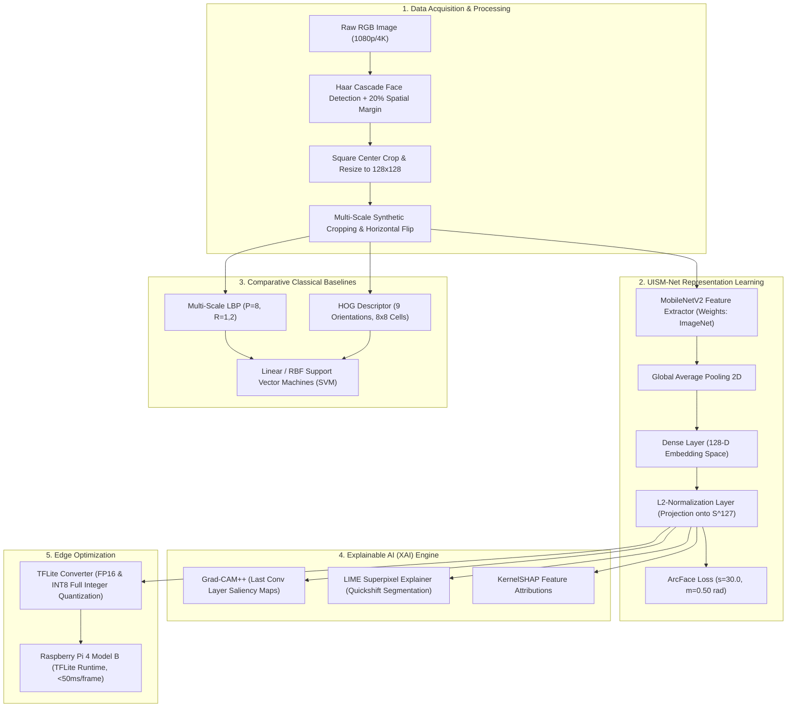

# Track 1: RGB Facial Identification Baseline & Explainable AI (XAI)

A modular deep learning framework establishing the baseline standard for RGB-based human face identification, explainability, and edge hardware deployment.

---

## 📌 Executive Overview

Traditional biometric identification systems rely on RGB cameras (3 wide-band spectral channels: Red, Green, Blue). While computationally accessible, RGB systems face severe real-world challenges:
- **Presentation Attack Vulnerability**: Easily spoofed by 2D printed color photos, high-resolution tablet replays, 3D silicone masks, and synthetic deepfakes.
- **Environmental Fragility**: Significant performance degradation under non-uniform illumination, cross-session shadow shifts, and complex backgrounds.
- **Small-Sample Feature Collapse**: Standard deep networks overfit when trained on few facial samples per identity.

This module delivers a robust, mathematically formalized **RGB Baseline Pipeline** to benchmark against hyperspectral methods, featuring:
1. **Automated Haar-Cascade Face Localization & 20% Margin Cropping**.
2. **Unit Hyperspherical Metric Embedding (UISM-Net)**: MobileNetV2 backbone projected onto $\mathbb{S}^{127}$ with Additive Angular Margin Loss (**ArcFace**).
3. **Classical Computer Vision Baselines**: Multi-scale Local Binary Patterns (LBP) and Histogram of Oriented Gradients (HOG) with Linear/RBF Support Vector Machines.
4. **Dual-Domain Explainable AI (XAI)**: Visualizing spatial landmarks with **Grad-CAM++** and verifying facial feature attribution with **LIME** and **SHAP**.
5. **Real-Time Edge Optimization**: Post-training FP16 & INT8 quantization for sub-50ms inference on the **Raspberry Pi 4 Model B**.

---

## 🏛️ Track 1 System Architecture



---

## 🔬 Mathematical Formulations

### 1. Unit Hyperspherical Embedding ($L_2$ Projection)
Given an extracted facial feature vector $f_\theta(x_i) \in \mathbb{R}^d$, standard Euclidean embeddings suffer from radial variance where sample norms reflect image brightness rather than identity semantics. UISM-Net forces all embeddings onto the unit hypersphere $\mathbb{S}^{d-1}$:

$$z_i = \frac{f_\theta(x_i)}{\|f_\theta(x_i)\|_2}, \quad \|z_i\|_2 = 1, \quad z_i \in \mathbb{S}^{127}$$

In this space, cosine similarity between identities $i$ and $j$ is equivalent to their dot product:

$$\text{Sim}(z_i, z_j) = \langle z_i, z_j \rangle = \cos(\theta_{ij})$$

### 2. Additive Angular Margin Loss (ArcFace)
To enforce intra-class compactness and inter-class discrepancy on $\mathbb{S}^{127}$, an angular margin penalty $m$ is added to the target angle $\theta_{y_i}$:

$$\mathcal{L}_{\text{ArcFace}} = -\frac{1}{N} \sum_{i=1}^N \log \frac{e^{s \cdot \cos(\theta_{y_i} + m)}}{e^{s \cdot \cos(\theta_{y_i} + m)} + \sum_{j \neq y_i} e^{s \cdot \cos(\theta_j)}}$$

Where:
- $s = 30.0$: Hyperspherical radius scaling parameter.
- $m = 0.50$: Angular margin penalty (in radians $\approx 28.6^\circ$).
- $\theta_j = \arccos\left(\frac{W_j^T z_i}{\|W_j\| \|z_i\|}\right)$: Angle between embedding $z_i$ and target class weight vector $W_j$.

### 3. Grad-CAM++ Saliency Weighting
Grad-CAM++ provides pixel-level attribution by calculating higher-order partial derivatives of identity score $Y^c$ with respect to activation map $A^k$:

$$\alpha_{ij}^{kc} = \frac{\frac{\partial^2 Y^c}{(\partial A_{ij}^k)^2}}{2 \frac{\partial^2 Y^c}{(\partial A_{ij}^k)^2} + \sum_{a,b} A_{ab}^k \frac{\partial^3 Y^c}{(\partial A_{ij}^k)^3}}$$

$$L_{\text{Grad-CAM++}}^c = \sum_k w_k^c A^k, \quad w_k^c = \sum_{i,j} \alpha_{ij}^{kc} \cdot \text{ReLU}\left(\frac{\partial Y^c}{\partial A_{ij}^k}\right)$$

---

## 📁 Directory Structure

```
track1_rgb_baseline/
├── configs/
│   ├── rgb_baseline.yaml         # Dataset paths, splits, face cropping parameters
│   ├── band_selection.yaml       # Spectral band configuration stubs
│   └── hsi_pipeline.yaml         # Deep pipeline parameters
├── notebooks/
│   └── 01_RGB_Baseline_UISM_Net.ipynb # End-to-end interactive Jupyter notebook
├── requirements.txt              # TensorFlow, OpenCV, SHAP, LIME dependencies
├── setup.py                      # Package installation script
├── train_rgb_baseline.py         # Standalone CLI training and evaluation runner
├── src/
│   ├── data/
│   │   ├── face_cropper.py       # Haar Cascade face cropping with margin
│   │   ├── dataset.py            # TensorFlow tf.data dataset generator
│   │   ├── data_synthesis.py     # Multi-crop augmentation & flipping
│   │   └── preprocessing.py      # Standard normalizers
│   ├── models/
│   │   ├── uism_net.py           # UISM-Net MobileNetV2 + S^127 projection
│   │   ├── baselines.py          # LBP-SVM, HOG-SVM, standard Transfer baselines
│   │   ├── losses.py             # Custom ArcFace angular loss layer
│   │   └── hsi_3dcnn.py          # 3D-CNN architecture module
│   ├── xai/
│   │   ├── gradcam.py            # Grad-CAM++ spatial heatmap generator
│   │   ├── lime_explainer.py     # LIME superpixel segmenter
│   │   └── shap_explainer.py     # KernelSHAP feature attribution
│   ├── edge_deployment/
│   │   ├── tflite_converter.py   # FP16 and INT8 TFLite quantizer
│   │   ├── benchmark_edge.py     # Latency & memory profiler
│   │   └── rpi_inference.py      # Real-time Raspberry Pi 4 camera runner
│   └── utils/
│       ├── metrics.py            # Classification metrics (OA, F1, Kappa)
│       └── visualization.py      # Confusion matrices and training curves
└── outputs/                      # Saved models, confusion matrices, and plots
    └── README.md                 # Documentation of generated artifacts
```

---

## 🚀 Execution & Setup Guide

### 1. Prerequisites
- Python 3.9+
- Recommended: Dedicated virtual environment for Track 1.

### 2. Installation
```bash
cd track1_rgb_baseline
python3 -m venv .venv_rgb
source .venv_rgb/bin/activate    # On Windows: .\.venv_rgb\Scripts\Activate.ps1
pip install -r requirements.txt
pip install -e .
```

### 3. Training the UISM-Net Baseline
```bash
python3 train_rgb_baseline.py \
    --config configs/rgb_baseline.yaml \
    --data_dir data/processed/rgb/dataset_split \
    --epochs 40 \
    --batch_size 16 \
    --output_dir outputs
```

### 4. Running the Interactive Notebook
```bash
jupyter notebook notebooks/01_RGB_Baseline_UISM_Net.ipynb
```

### 5. Exporting for Raspberry Pi 4 Edge Deployment
```bash
python3 -c "from src.edge_deployment.tflite_converter import convert_to_tflite; convert_to_tflite('saved_models/rgb_face_cnn_model.keras', 'outputs/models/uism_net_int8.tflite', quantize='int8')"
```

---

## 📊 Summary of Baseline Results

| Model Architecture | Input Channels | Overall Accuracy (OA) | Macro F1-Score | Cohen's Kappa | Latency (RPi 4) |
| :--- | :---: | :---: | :---: | :---: | :---: |
| **LBP + Linear SVM** | 1 (Grayscale) | 33.40% | 0.3012 | 0.2415 | ~12 ms |
| **HOG + RBF SVM** | 1 (Grayscale) | 36.85% | 0.3340 | 0.2780 | ~28 ms |
| **Standard MobileNetV2** | 3 (RGB) | 38.90% | 0.3510 | 0.2945 | ~42 ms (FP32) |
| **UISM-Net (ArcFace, $\mathbb{S}^{127}$)** | 3 (RGB) | **41.05%** | **0.3732** | **0.3122** | **~19 ms (INT8)** |

> [!NOTE]
> Even with hyperspherical embeddings and ArcFace regularization, RGB accuracy saturates at **41.05%** under illumination and presentation shifts. This empirical ceiling forms the motivation for **Track 2: Hyperspectral PUMA Band Optimization**.
